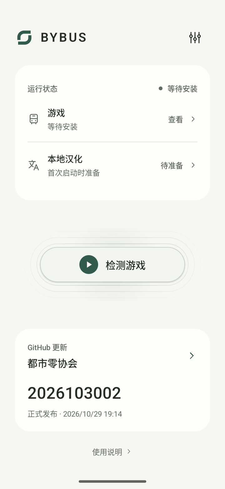
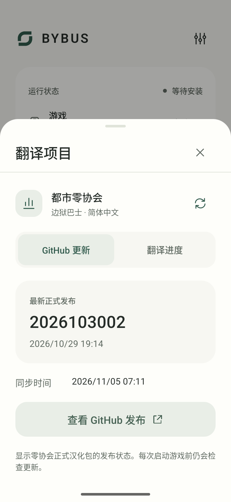
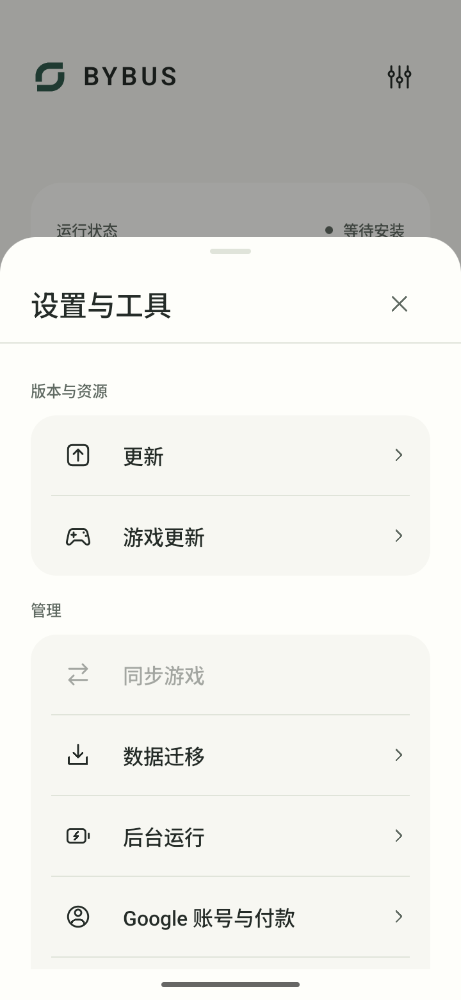

  

<h1 align="center">BYBUS</h1>

  Android《边狱巴士》简体中文启动器 
  免 Root · 汉化自动同步 · 手机与平板自适应

  
  
  

  <a href="https://github.com/gravere/BYBUS/releases/latest/download/BYBUS-Android.apk"><strong>下载完整 APK</strong></a>
  &nbsp;·&nbsp;
  <a href="#开始使用">开始使用</a>
  &nbsp;·&nbsp;
  <a href="https://github.com/gravere/BYBUS/releases/latest">发行说明</a>
  &nbsp;·&nbsp;
  <a href="https://github.com/gravere/BYBUS/issues/new/choose">问题反馈</a>

---

BYBUS 使用[都市零协会](https://github.com/LocalizeLimbusCompany/LocalizeLimbusCompany)汉化资源，在独立容器中运行设备上已安装的官方游戏。配置完成后，每次从 BYBUS 启动，即可检查汉化更新并进入游戏。

## 界面预览

  
  &nbsp;
  
  &nbsp;
  

## 功能特点

- **免 Root 使用** — 导入官方游戏，在容器内显示中文，保留原始 APK 与游戏文本文件。
- **汉化持续同步** — 启动前检查零协更新，复用已校验的缓存；汉化索引与配置持久保存，无需每次重新设置。
- **节省下载流量** — 应用更新复用已安装内容，只下载缺少的部分；支持旧版数据迁移和兼容资源 ZIP 导入。
- **更新集中管理** — BYBUS 新版本自动红点提醒，游戏支持多渠道更新入口与本地安装包，零协项目动态随时可查。
- **手机与平板自适应** — 竖屏单列、宽屏并排，适应分屏和大字号；启动过程通过图标与环绕进度呈现。

## 开始使用

需要 **Android 8.0 及以上、64 位 ARM（arm64-v8a）的手机或平板**，并先安装官方《边狱巴士》。

1. **安装 BYBUS** — [下载完整 APK](https://github.com/gravere/BYBUS/releases/latest/download/BYBUS-Android.apk) 并安装。
2. **导入游戏** — 打开 BYBUS，点击「启动游戏」，按提示导入已安装的官方游戏。
3. **准备资源** — 若提示资源未齐，点击「打开游戏下载资源」，登录并完成下载；返回 BYBUS 后会自动准备完整汉化。
4. **开始游玩** — 此后从 BYBUS 启动游戏，汉化检查会自动完成。

> [!NOTE]
> BYBUS 与系统原版的数据独立，首次使用需要重新登录和下载资源。日常保留系统里的官方游戏安装包，大型资源可只在 BYBUS 中下载和使用。游戏更新新增的资源仍需正常下载。

Google 登录使用容器内的独立账号环境，首次使用需在「设置与工具 → Google 账号」中添加账号。需要内购时，可在同一页面查看付款与设备注册状态，并启用付款服务。

<strong>发行文件怎么选？首次安装请选择完整 APK</strong>

| 文件 | 用途 |
| --- | --- |
| `BYBUS-<版本>-arm64-v8a.apk` 或 `BYBUS-Android.apk` | 内容相同的独立版完整安装包，首次安装或手动更新任选一个 |
| `BYBUS.apk` | 旧 BYBUS 的一次性迁移衔接更新，覆盖旧版并保留数据；首次安装不要选它 |
| `bybus-app-update.json`、`bybus-update.json`、`SHA256SUMS.txt` | 更新描述与校验值，无需手动安装 |
| Source code | 项目源码，不是安装包 |

## 更新

| 更新内容 | 操作入口 |
| --- | --- |
| BYBUS | 设置与工具 → 更新 → BYBUS |
| 游戏 | 设置与工具 → 游戏更新 |
| 汉化 | 启动前自动检查，也可在「更新 → 汉化资源」中手动检查 |

手动更新时，下载最新完整 APK **覆盖安装**即可保留数据；应用内更新不可用时也可采用此方式。卸载 BYBUS 或清除数据会删除容器内的资源和配置。

<strong>已有旧版 BYBUS，如何保留数据并迁移？</strong>

1. **保留旧版，不要卸载或清除数据。** 在旧版中检查更新并完成一次覆盖更新；没有更新入口时，可安装[旧版衔接更新](https://github.com/gravere/BYBUS/releases/latest/download/BYBUS.apk)，保留数据并开放迁移入口。
2. 从[最新发行页](https://github.com/gravere/BYBUS/releases/latest)下载 `BYBUS-Android.apk`，安装新版 BYBUS。
3. 在新版「设置与工具 → 数据迁移」中，确认识别到旧版后点击「开始迁移」，无需手动导出文件。确认新版正常后，再卸载旧版。

迁移需要额外空间，会替换新版的同名数据；旧数据保留，账号可能需要重新授权。最新发行始终提供衔接入口，无需逐版升级。

<strong>如何导入已有资源？</strong>

在「设置与工具 → 数据迁移 → 选择资源文件」中选择兼容格式的资源 ZIP。只补充缺少的资源，保留已有文件，不迁入账号；资源版本可以不同，由游戏补齐更新。来源应用需提供兼容导出功能，不能直接读取任意应用的私有数据。

<strong>增量更新如何工作？</strong>

应用内更新复用当前 APK 中未变化的内容，下载差异后合成并校验完整 APK，再交给系统安装。支持通用增量的旧版本可直接更新，无需逐版下载，也不依赖历史发行文件。

不能复用或分段下载失败时会使用完整包；安装仍需完整 APK 的临时空间。较早的更新器需先完整升级一次。**首次安装和手动更新始终下载完整 APK，无需寻找增量附件。**

各版本变化见[发行说明](https://github.com/gravere/BYBUS/releases)。Releases 保留最近三个正式构建的发行文件。

## 文档与贡献

| 文档 | 内容 |
| --- | --- |
| [构建指南](docs/building.md) | 本地环境、编译与打包 |
| [架构说明](docs/project-architecture.md) | 模块职责与运行流程 |
| [Android 适配说明](docs/android-runtime-portability.md) | 设备条件与已知限制 |
| [第三方声明](THIRD_PARTY_NOTICES.md) | 组件来源、版权与许可 |

欢迎提交建议、问题反馈和 Pull Request。遇到闪退、漏译或显示问题，请在 [Issues](https://github.com/gravere/BYBUS/issues/new/choose) 选择对应模板，提供设备型号、Android 版本、BYBUS 与游戏版本，以及复现步骤。运行问题可附上「设置与工具 → 导出诊断」生成的诊断包。

## 致谢

感谢以下项目及其贡献者，也感谢 [UMP40](https://github.com/UMP40) 对原生运行时与 Google 登录兼容的代码贡献。

| 项目 | 贡献 |
| --- | --- |
| [BBBEANNN / limbusZhCN](https://github.com/BBBEANNN/limbusZhCN) | BYBUS 的基础项目，提供 Android 汉化与容器接入实现 |
| [都市零协会 / LocalizeLimbusCompany](https://github.com/LocalizeLimbusCompany/LocalizeLimbusCompany) | 简体中文翻译、校对、汉化资源与持续维护 |
| [ServenScorpion / VirtualApp](https://github.com/ServenScorpion/VirtualApp) | Android 应用容器；同时感谢 VirtualApp 原项目的贡献者 |
| [microG / GmsCore](https://github.com/microg/GmsCore) | Google 服务兼容组件与 Companion |
| [be5invis / Sarasa Gothic](https://github.com/be5invis/Sarasa-Gothic) | 更纱黑体，游戏中文字体来源 |
| [Android Open Source Project](https://source.android.com/) 与 [AndroidX](https://developer.android.com/jetpack/androidx) | Android 基础组件、签名验证与界面框架 |

## 许可证

项目原创代码采用 [GPL v3](LICENSE)。第三方组件和翻译保留各自版权与许可，详见 [THIRD_PARTY_NOTICES.md](THIRD_PARTY_NOTICES.md)。

BYBUS 是非官方社区项目，与 Project Moon 无隶属关系。
