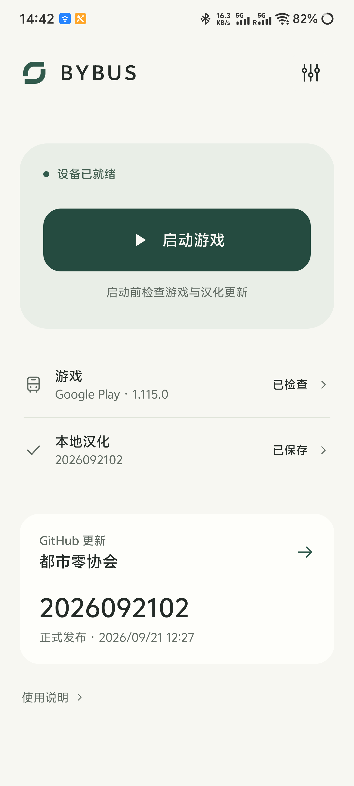
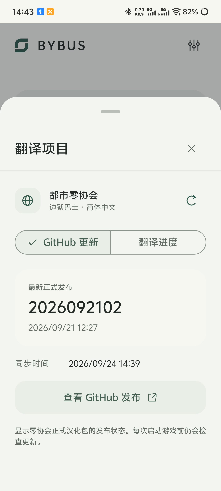
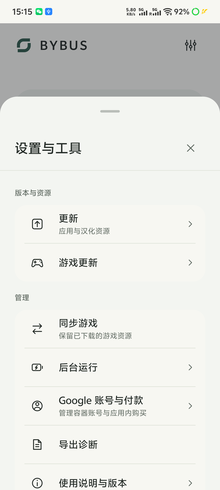

  

<h1 align="center">BYBUS</h1>

  Android《边狱巴士》简体中文启动器 
  免 Root · 汉化自动同步 · 手机与平板自适应

  
  
  

  <a href="https://github.com/gravere/BYBUS/releases/latest/download/BYBUS.apk"><strong>下载完整 APK</strong></a>
  &nbsp;·&nbsp;
  <a href="#开始使用">开始使用</a>
  &nbsp;·&nbsp;
  <a href="https://github.com/gravere/BYBUS/releases/latest">发行说明</a>
  &nbsp;·&nbsp;
  <a href="https://github.com/gravere/BYBUS/issues/new/choose">问题反馈</a>

---

BYBUS 使用[都市零协会](https://github.com/LocalizeLimbusCompany/LocalizeLimbusCompany)汉化资源，在独立容器中运行设备上已安装的官方游戏。配置完成后，每次从 BYBUS 启动，即可检查汉化更新并进入游戏。

## 功能特点

- **免 Root 使用** — 导入官方游戏，在容器内显示中文，保留原始 APK 与游戏文本文件。
- **汉化持续同步** — 启动前检查零协更新，复用已校验的缓存；汉化索引与配置持久保存，无需每次重新设置。
- **减少下载负担** — 大型游戏资源可只在 BYBUS 内下载；应用自身支持增量更新，匹配到差异补丁时减少更新流量。
- **多渠道游戏更新** — 支持 Google Play、Uptodown 等更新入口与本地安装包，更新安装文件时保留容器资源和账号数据。
- **零协项目动态** — 默认展示 GitHub 更新状态，可切换 ParaTranz 查看可用统计或前往项目页面。
- **适应不同屏幕** — 竖屏单列，横屏在空间足够时使用双列，随分屏窗口和系统字体大小调整布局。

## 应用截图

| 启动与汉化 | 零协项目动态 | 设置与工具 |
| :---: | :---: | :---: |
|  |  |  |

截图展示应用界面，版本、日期与项目状态以应用内实时信息为准。

## 开始使用

需要 **Android 8.0 及以上、64 位 ARM（arm64-v8a）的手机或平板**，并先安装官方《边狱巴士》。详细条件见[兼容范围](#兼容范围)。

1. **安装 BYBUS** — [下载完整 APK](https://github.com/gravere/BYBUS/releases/latest/download/BYBUS.apk) 并安装。
2. **导入游戏** — 打开 BYBUS，点击「启动游戏」，按提示导入已安装的官方游戏。
3. **准备资源** — 首次进入时登录账号并下载游戏资源；完成后返回 BYBUS，再启动一次以启用完整汉化。
4. **开始游玩** — 此后从 BYBUS 启动游戏，汉化检查会自动完成。

> [!NOTE]
> BYBUS 与系统原版的数据独立，首次使用需要重新登录和下载资源。日常保留系统里的官方游戏安装包，大型资源可只在 BYBUS 中下载和使用。游戏更新新增的资源仍需正常下载。

首次下载资源前，可先准备启动、登录和提示文本的汉化；完整汉化需要游戏资源下载完成。Google 登录使用容器内的独立账号环境，新设备需添加账号，不能直接沿用系统 Play 商店的登录状态。

<strong>发行文件怎么选？首次安装请选择完整 APK</strong>

| 文件 | 用途 |
| --- | --- |
| `BYBUS-<版本>-arm64-v8a.apk` 或 `BYBUS.apk` | 内容相同的完整安装包，首次安装或手动更新任选一个 |
| `.delta` | 应用自动处理的差异补丁，不能独立安装，首次使用无需下载 |
| `bybus-update.json`、`SHA256SUMS.txt` | 更新元数据与校验值，无需手动安装 |
| Source code | 项目源码，不是安装包 |

## 更新

| 更新内容 | 操作入口 |
| --- | --- |
| BYBUS | 设置与工具 → 更新 → 检查应用更新 |
| 游戏 | 设置与工具 → 游戏更新 |
| 汉化 | 启动前自动检查，也可在「更新」中手动检查 |

手动更新时，下载最新完整 APK **覆盖安装**即可保留数据；应用内更新不可用时也可采用此方式。卸载 BYBUS 或清除数据会删除容器内的资源和配置。

<strong>增量更新如何工作？</strong>

应用会在已安装 APK 与发行补丁匹配时优先下载差异内容，自动合成并校验完整 APK，再打开系统安装页面；无匹配补丁或合成失败时使用完整包。增量更新减少下载流量，合成与安装仍需完整 APK 的临时空间。

如果旧安装包没有增量更新能力，直接下载最新完整 APK 覆盖升级即可。

各版本变化见[发行说明](https://github.com/gravere/BYBUS/releases)。Releases 保留最近三个正式构建的发行文件。

## 兼容范围

BYBUS 面向 Android 手机和平板，不限定品牌。启动前会检查设备条件、官方游戏签名及原生结构。

| 项目 | 要求或说明 |
| --- | --- |
| 系统与处理器 | Android 8.0 及以上、arm64-v8a；不支持 32 位系统或 x86 |
| 内存页大小 | 按设备实际的 4 KB / 16 KB 页大小检查运行条件 |
| 游戏版本 | 同结构更新可自动适配；新的保护结构可能需要更新 BYBUS，未识别结构不支持 |
| 汉化覆盖 | 取决于零协已发布的译文，以及设备上已下载的游戏资源 |

内置 Google 组件仍有部分 4 KB 原生库，**16 KB 设备上的 Google 登录和付款兼容性尚未确认**。通过启动前检查不代表所有设备、页面和功能均已实测，详见[Android 适配说明](docs/android-runtime-portability.md)。

## 文档与贡献

| 文档 | 内容 |
| --- | --- |
| [构建指南](docs/building.md) | 本地环境、编译与打包 |
| [架构说明](docs/project-architecture.md) | 模块职责与运行流程 |
| [Android 适配说明](docs/android-runtime-portability.md) | 设备条件与已知限制 |
| [第三方声明](THIRD_PARTY_NOTICES.md) | 组件来源、版权与许可 |

欢迎提交建议、问题反馈和 Pull Request。遇到闪退、漏译或显示问题，请在 [Issues](https://github.com/gravere/BYBUS/issues/new/choose) 选择对应模板，提供设备型号、Android 版本、BYBUS 与游戏版本，以及复现步骤。运行问题可附上「设置与工具 → 导出诊断」生成的诊断包。

## 致谢

感谢以下项目及其贡献者，也感谢 [UMP40](https://github.com/UMP40) 对原生运行时与 Google 登录兼容的代码贡献。

| 项目 | 贡献 |
| --- | --- |
| [BBBEANNN / limbusZhCN](https://github.com/BBBEANNN/limbusZhCN) | BYBUS 的基础项目，提供 Android 汉化与容器接入实现 |
| [都市零协会 / LocalizeLimbusCompany](https://github.com/LocalizeLimbusCompany/LocalizeLimbusCompany) | 简体中文翻译、校对、汉化资源与持续维护 |
| [ServenScorpion / VirtualApp](https://github.com/ServenScorpion/VirtualApp) | Android 应用容器；同时感谢 VirtualApp 原项目的贡献者 |
| [microG / GmsCore](https://github.com/microg/GmsCore) | Google 服务兼容组件与 Companion |
| [be5invis / Sarasa Gothic](https://github.com/be5invis/Sarasa-Gothic) | 更纱黑体，游戏中文字体来源 |
| [Android Open Source Project](https://source.android.com/) 与 [AndroidX](https://developer.android.com/jetpack/androidx) | Android 基础组件、签名验证与界面框架 |

## 许可证

项目原创代码采用 [GPL v3](LICENSE)。第三方组件和翻译保留各自版权与许可，详见 [THIRD_PARTY_NOTICES.md](THIRD_PARTY_NOTICES.md)。

BYBUS 是非官方社区项目，与 Project Moon 无隶属关系。
