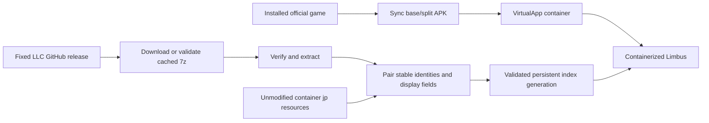

# Project Architecture Notes

This document keeps the longer project background out of `AGENTS.md`.

Current text-index revision is schema 9. The 2026-09-23 update adds sparse identity/field/full-source contexts, verified built-in BattleHint sources, RPG localization fields and formatting boundaries. The older schema-8 discussion below describes the preceding term-index foundation; current coverage and remaining gaps are recorded in [text-coverage-audit.md](text-coverage-audit.md).

## Overview

The app is an Android Chinese-localization companion for `com.ProjectMoon.LimbusCompany`.
The production path is container mode:

1. Import or synchronize the officially signed Limbus APK/splits installed on the device, regardless of installation channel.
2. Stop the previous guest, check the fixed LLC release source, and validate persistent translation files.
3. Pair Japanese resource text with Chinese text and atomically activate a complete host-owned index.
4. Launch the game inside VirtualApp. The native text layer reads that index; original game resource files remain unchanged.

The project does not modify the game APK and does not rely on Frida or Shizuku.

Native startup qualification now accepts either an exact legacy profile or the independently
verified engine family described in [automatic-native-compatibility.md](automatic-native-compatibility.md).
The family path reads the current signed APK's ELF geometry and compares original game verifier
expectations with complete recomputed sections/ranges after normalizing only registered patches.
It does not require a catalog entry or a rebuilt launcher for every same-family version number.

## Modules

- `:app`: Kotlin / Jetpack Compose UI and localization workflow.
- `LaunchCoordinator`: application-owned state and work queue; `LauncherViewModel` is a UI facade. `OperationLock` covers UI, debug and other process writers.
- `:virtualapp`: vendored VirtualApp Android 12 source under `third_party/virtualapp-upstream/lib`.
- `container`: runtime boundary for import, launch, storage, and patch installation.
- `gamefs`: `GameStorage` abstraction for container data access.
- `update`: GitHub Releases discovery, hash checking, `.7z` extraction, and patch cache manifest generation.
- `TranslationRepository`: download/cache ownership and retention; `TranslationJsonPairer`: pure identity and field matching; `TranslationIndexStore`: generation validation and activation.
- `DeviceCompatibility`: Android API 26+ / ARM64 prerequisites, actual 4 KiB or 16 KiB page size, process architecture, low-RAM/background-policy inspection and OEM settings fallback. Native structure qualification remains separate; see [Android portability](android-runtime-portability.md).
- `PersistentDiagnosticLog` / `DebugLogExporter`: per-process bounded logs, uncaught exception capture, redaction, exit reasons, and Issue ZIP generation.

## Startup latency and handoff (2026-10-12)

The launch button stays busy through preparation and the actual VirtualApp Activity
handoff. `startActivity` accepting an Intent is not completion: the launch worker
waits for the existing per-Intent `UiCallback.onAppOpened` from the requested game
and user. The wait is bounded and reports a missing handoff instead of leaving the
button disabled indefinitely. Each launch owns its callback; late acknowledgments
cannot complete a later request. No fixed visual delay or extra game launch is used.

Release metadata checking starts alongside local preparation and joins the shared
GitHub repository's existing quota-aware check. With a local translation candidate,
network waiting has a four-second budget from launch preparation; expiration uses
only the fully revalidated local package/index. Without local files, the initial
check may wait up to fifteen seconds. A slow request may finish updating metadata
in the background, but cannot install translation files or change a completed
launch. There is at most one outstanding launch metadata request. Downloads,
validation and index rebuilding have distinct progress labels. Game-store checks
remain independent of preparation.

Archive validation and build fingerprinting share content digests only within one
locked preparation operation. Reuse requires unchanged file identity, size and
modification/creation times; changed files are hashed again. Every new launch still
reads and validates all translation bytes, all Japanese inputs and the active
index. Rebuild stability checks always reread inputs. This does not replace
integrity validation with a persistent metadata-only cache. Timings are recorded
per phase in the bounded, redacted diagnostic log.

## Runtime Flow



## Container Data Preservation

After the game reaches the post-login resource download flow, the VirtualApp
game data/storage directories are treated as durable state. They may contain
the downloaded Limbus resources, which are large enough that clearing the
container forces a full re-download.

Resynchronizing the installed official game must therefore update only the imported
APK/split sources and native libraries. Do not uninstall
`com.ProjectMoon.LimbusCompany`, clear its VirtualApp data directory, or remove
its virtual external storage as part of routine sync or launch repair.

After the system-installed game is updated through its chosen channel, use the
installed-game sync path to re-import the current host
`base.apk` and split APKs into the container while preserving container data.

Game launch should treat synchronization as an automatic guard rather than a
normal user-facing step:

- If the container has no imported game record, copy the host Google Play
  install, import it into VirtualApp, then launch.
- If the host Google Play version differs from the recorded container version,
  re-import the host APK/splits, then launch.
- If versions, source paths and committed import state match, skip import; translation checking still runs.
- If an import repair marker exists or the virtual package is missing, synchronize from the installed game before normal launch.

Import copies all APKs into a unique immutable generation and verifies their hashes before external installation. A durable repair marker covers the nontransactional VirtualApp operation. Only successful installation and native-library preparation advance committed metadata. The current and previous snapshots remain available; a failed external install requires a fresh synchronization. Native libraries are staged in a sibling directory before replacement. Neither operation removes guest data.

## Important Paths

Container-visible localization root:

```text
/sdcard/Android/data/com.ProjectMoon.LimbusCompany/files/Assets/Resources_moved/Localize/
├── RemoteLocalizeFileList.json
├── localize_en.zip
├── en/
├── jp/
├── kr/
├── etc/VoiceTable.json
└── Temp/LocalizeTemp_en/LocalizeTemp_en/
```

The game text files are downloaded only after login reaches the main flow, so the directory can be empty during title/login debugging.

## Patch Rules

Only explicit display-text fields may be changed. The current whitelist covers
ordinary copy, dialogue, names and descriptions, including `content`, `dialog`,
`dlg`, `teller`, `name`, `nameWithTitle`, `desc`, `description`, `title`,
`summary`, `flavor`, and `place`, plus the additional display-only fields listed
in `ContainerPatchInstaller.TEXT_FIELDS`. Do not change metadata fields such as
`id`, `personalityid`, `voicefile`, `usage`, `model`, or icon/resource keys.

## Localization Preparation

Once the game has entered the post-login main flow and downloaded
`Localize/en`, use the debug snapshot exporter to copy a read-only archive of
the container-visible Localize tree into the localizer app's own external files
directory:

```powershell
adb -s <device> shell am start -n com.example.limbuszhcn/.MainActivity --ez export_localize_snapshot true
adb -s <device> shell ls /sdcard/Android/data/com.example.limbuszhcn/files/diagnostics/localize-snapshots
adb -s <device> pull /sdcard/Android/data/com.example.limbuszhcn/files/diagnostics/localize-snapshots/<snapshot>.zip .diagnostics/
```

The exporter does not modify game resources. It only reads the VirtualApp
Localize root and writes a zip plus a small summary file.

After pulling the snapshot, prepare a translation catalog on the workstation:

```powershell
python .\scripts\localize_catalog.py export `
  --input .\.diagnostics\<snapshot>.zip `
  --output .\.diagnostics\localize-catalog.jsonl `
  --summary .\.diagnostics\localize-catalog-summary.json
```

Each JSONL row contains `path`, `index`, `id`, `field`, `source`, and an empty
`translation`. Only fill `translation`; keep `path`, `index`, `id`, and `field`
stable so the apply step can patch the original JSON safely.

To build a patch directory from a translated catalog:

```powershell
python .\scripts\localize_catalog.py apply `
  --input .\.diagnostics\<snapshot>.zip `
  --catalog .\.diagnostics\localize-catalog.translated.jsonl `
  --output-dir .\.diagnostics\prepared-patch
```

The generated patch directory is shaped as `files/en/...` and only contains
JSON files whose allowed text fields changed.

## Translation Download Source

GitHub Releases is the only supported translation-package source. The launcher fixes the endpoint to `https://api.github.com/repos/LocalizeLimbusCompany/LocalizeLimbusCompany/releases/latest` and selects exactly one `LimbusLocalize_<numeric-tag>.7z` asset. JSON parsing is independent of property order and accepts a null digest. Published SHA-256 values are verified; a locally computed archive hash and extracted file hashes are persisted and checked on reuse. When the upstream digest is absent, the local hash proves cache consistency, not independent publisher authentication.

The production path must not accept relay endpoints, access tokens, or arbitrary
download services. Do not pin it to a single tag such as `2026071001`; that tag
is only useful as a known-good format sample.

## Installation and deactivation

Production uses only the runtime text index. The names `activateRedirect` and `refreshActiveRedirects` remain for source compatibility, but do not enable file-read redirects. Deactivation removes only host-owned pointers and receipts and is safe to repeat, including when a newer release is merely cached. It never deletes `Localize/en`, Japanese originals or `Lang` files.

`LegacyFilePatchMigration` is an explicit internal migration path with ownership receipts and verified restoration baselines. It is not a fallback for normal deactivation and has no user-facing automatic entry. Restoration refuses to overwrite resources changed by the game since patch installation.

## Runtime Translation Index

The file redirect experiment proved that enabling redirects after login is too
late: the official localization tables have already been loaded into the game.
The replacement data path is therefore a versioned, host-private text index.

The production path is a Japanese-only full text takeover modeled on the observed
OurPlay pipeline. During translation activation, `ContainerPatchInstaller`
recursively pairs the translated JSON with the container-visible official Japanese
JSON. Stable `id` values are preferred for array alignment, while matching nested
arrays such as skill levels and coin descriptions are traversed structurally. Only
explicitly whitelisted display fields enter the runtime index. String arrays in
`successDesc`, `failureDesc` and `result` use the same
policy: match the owning object first, require equal lengths and string-only
elements, then pair the declared order. Metadata arrays are never translated.
At runtime these fields use exact-signature reflected System.Array/List methods,
with per-thread metadata caches and bounded counts; no managed offsets are guessed.
Ambiguous source
strings are counted and excluded from the context-free fallback. Schema 8 also
stores a curated short-term table for longest-match replacement inside formatted
or rich text. Dominant conflicts are accepted only with at least three samples,
80% support and a 3x lead over the runner-up. Paired square brackets and TMP rich
text tags are removed when deriving terms, so sources such as `[攻撃前]` and
`<color><s>長姉</s></color>` also cover their embedded runtime forms.
Runtime longest-match replacement copies complete `<...>` TMP tags without
inspection and requires word boundaries around ASCII-only terms. Schema 8 keeps
expanding package terms such as `以上 -> 或以上`, while the native matcher detects
whether a source occurrence is already inside the complete translated value. This
makes repeated `SkillPerLevel -> Skill -> TMP` passes idempotent without discarding
verified translations from the downloaded package.
The compiler and native object-graph traversal use the same explicit display-field
policy. In addition to the original skill/UI fields, schema 8 includes verified
display values such as `story`, `relatedChapterText`, and `openConditionNumber`.
Translations containing Unicode replacement characters or illegal control bytes
are omitted so a damaged package entry leaves the official Japanese text intact.

TMP text assignment is the final UI fallback, not the complete translation path.
Character, identity, skill and story text must also be intercepted while the game
obtains or formats strings from `TextData_*` and related localization objects. This
keeps the index Japanese-only without reducing coverage to static UI labels.
The native layer enumerates every runtime class whose name starts with
`TextData_`, then hooks instance string-returning formatters with zero to two
ABI-checked parameters only when the method has enough space (16/20 bytes) before
the next known managed method body. On Limbus
1.109.1 this discovered 59 classes and safely installed 54 one-argument plus four
two-argument formatters, covering UI, passive, abnormality event, EGO gift,
mirror/railway, quest, lyrics and Dante-note text without a page-level whitelist.
Before the per-level skill formatter runs, it also traverses the whitelisted
`levelList`, `coinlist` and `coindescs` graph through reflected `List<T>` methods;
no managed list or array offsets are hard-coded.
Direct short getters are intentionally left to exact TMP/UI replacement because
the legacy ARM64 inline-hook prologue is wider than several adjacent getter bodies.
For Dante-note paragraphs, the game inserts `line-height` tags around newline
boundaries after localization lookup. An exact miss may retry after removing only
those layout tags; a successful translation reapplies the same 170%/100% paragraph
spacing to Chinese newlines. Color, sprite, link and style markup is never removed
by this normalization.

Font provenance is separate from translation. The runtime recognizes complete
released Chinese strings, safe decorative-tag/whitespace variations and bounded
numeric or known-name substitutions in complete templates. The observed introduction
preview's exact five-black-square placeholder (`■■■■■`) is also accepted as a
template argument; it never proves a label on its own. Other block counts, unknown
names, incomplete sentences and unsafe font/sprite tags remain rejected. It rejects arbitrary
substrings and unknown arguments. Matching Han labels intentionally unchanged by
LLC can prove font identity without resolving translation conflicts. Output and
match caches are bounded. Chinese primary-font switching uses TMP's material
conversion API to preserve the source preset and restore pooled components;
short dialog bodies retain wrapping unless their layout is actually single-line.

### Launcher workflow and resource readiness

The ordinary launcher path is a single `Launch translated game` action. It synchronizes the installed game only when needed, stops the old guest, checks the fixed LLC release, reuses a hash-validated archive when possible, prepares a complete index, and launches the guest. The source is not editable in the production UI. Offline fallback revalidates the active release archive, extracted files and index before requesting launch.

Package freshness, Japanese-resource readiness, and active-index state are
separate. A fresh game install or game update may not have downloaded its
`jp/JP_*.json` resources yet. Index compilation counts candidate translation JSON
files and valid, sufficiently paired Japanese counterparts. Missing translation files still count as candidates. Invalid JSON does not count as available. Stable identities must match without positional fallback; duplicate identities are rejected. Inputs must remain unchanged throughout compilation, and the record count must not collapse below 90 percent of the previous index. Fewer than 90 percent available sources
is a resource-preparation state: the package remains cached, any prior valid index
remains active, and no partial index or misleading active marker is written. The
game is launched so it can download resources after login. On the next launcher
run, the cached package is paired with the newly available sources and activated.
An individual exact-match miss remains Japanese and does not invalidate the rest
of the index.

Saved files, initialized container, native index loading and text-hook installation are separate states. Native launch receipts carry a fresh request token, and do not claim that the game screen, Chinese font or login actually succeeded. Version-specific native operations require a shipped profile matching the game version, Android API range, ABI and both native library hashes. The catalog contains exact game 471, 475 and 478 profiles for SDK 36 / arm64 / 4 KiB pages; unknown builds do not run those operations and may fail to enter the game. The 478 qualification and event text flow boundaries are recorded in `runtime-text-and-478.md`. See `text-coverage-audit.md` for current validation limits and `architecture-hardening.md` for earlier recovery design.

### User diagnostics export

The advanced launcher panel exposes a user-initiated ZIP diagnostics export. It
contains a human-readable runtime summary, recent logcat lines visible to the
host UID, historical process-exit reasons, and the active translation-index
manifest. This covers the host and VirtualApp guest processes because they share
the application UID, without requesting privileged device-wide log access.

Diagnostics are intentionally metadata-only. The exporter must not include
translation JSON, game saves, PlayerPrefs, updater configuration, account data, or
arbitrary container files. Before writing the archive it redacts authorization
headers, token-like fields, URL credentials, email addresses, and JWT-shaped
values. Each collected stream and the final archive are bounded so a runaway log
cannot exhaust storage. Android's document picker owns the final destination;
temporary archives remain in the application cache and are replaced on the next
export.

### Bundled microG bootstrap

The production application packages the exact microG Services and Companion
APKs already validated by the container login flow. A bundled properties
manifest pins each asset's package name, version code, SHA-256 digest and signing
certificate digest. Assets exceeding a source-hosting single-file limit are split
into ordered manifest-declared parts. On a fresh install, `MicrogContainerConfig`
concatenates those parts into host-private staging, verifies the complete APK byte
digest before publishing the staged set, and lets the existing VirtualApp
installation path validate package identity and install native libraries. No
network or debug intent is required.

Legacy devices with a complete externally staged set keep using it so an
application update does not unexpectedly replace a working login environment.
Fresh devices and devices whose bundled staging is incomplete rebuild from the
signed outer APK assets. Debug-only path/URL overrides remain available for
development, but are not part of the user workflow. The embedded Apache-2.0
license and component provenance are shipped alongside the APK assets.

This mode supports Japanese only. Immediately after the original `il2cpp_init`
returns, the runtime resolves `GlobalGameManager.get_Lang()` and forces its
runtime return value to `JP=2`; `LocalSave.LocalGameOptionData.GetLanguage()` is
retained only as a compatibility hook. Device validation must show an actual
language-getter hit because a successful hook-install log alone does not prove
that the game selected Japanese. The PlayerPrefs XML is not rewritten, so its
encryption key, IV and other user settings remain untouched. Japanese layout/font
materials stay active; the dynamic Chinese TMP fallback remains available for
missing glyphs.

Each compiled version is immutable:

```text
translation-cache/translation-index/
├── active-index.path
└── versions/<translation-version>/
    ├── index.bin
    └── manifest.properties
```

The version directory is written through a staging directory and renamed only
after all files are complete. `active-index.path` is then replaced atomically
and contains the absolute path of the selected `index.bin`. Disabling a
translation removes only this active pointer; version directories remain
available for rollback.

The Limbus guest process loads and validates `index.bin`, completes VirtualApp's
libc IO-hook pass, then intercepts the `dlsym("il2cpp_init")` result before Unity
loads the managed runtime. It installs acquisition and TMP hooks only after the original initializer
returns. This has no fixed startup delay, does not patch `il2cpp_init`, and does
not query a half-initialized domain. Exact
source matches are replaced with managed UTF-16 strings. The bundled
`ChineseFont.ttf` (Sarasa Gothic SC Bold, from the LLC translation project) is copied
once to host-private storage, converted to a dynamic 4096x4096 TMP SDF font and
registered in `TMP_Settings.fallbackFontAssets`. It is deliberately not assigned
as every component's primary font. The runtime tags only managed strings that it
creates as translation results. While one of those tagged strings is assigned,
the receiving TMP component temporarily uses the Chinese asset as its primary
font so common Han glyphs and Simplified-Chinese-only glyphs do not alternate
between the Japanese primary face and the fallback. The original font material is
remembered as well: outline width/color are copied onto the per-component Chinese
material so coin-skill text retains the game's black edge, and the exact material
is restored with the original font. Translated text without an explicit
`line-height` tag receives a small line-spacing floor before layout. This also
covers rows created by TMP automatic wrapping; checking only for literal newlines
left long skill descriptions overlapping. Single-line labels are unaffected
because line spacing is consumed only between generated rows. A reused component
is restored to its original font, material,
and spacing as soon as it receives an untagged string. This
must not be generalized to every non-ASCII string. A 1024 atlas caused old glyphs
to disappear after loading a skill screen, so both primary and fallback use the
same 4096x4096 dynamic asset. Font creation failure leaves the original text
unchanged. The fallback is prepared before any non-ASCII TMP text is laid out,
because a formatter may already have returned Chinese before the setter hook
runs; relying only on a setter-time replacement would leave the first such screen
without Chinese-only glyphs.

Translation identity and font evidence are separate. Weak IL2CPP GC handles prove
which live string objects were produced by the translator; a raw address or a
previously seen spelling cannot suppress a different resource's translation.
Unchanged source/target pairs participate in conflict detection. Sparse context
entries also cover source/target chains, so a Chinese output such as 防御 cannot
silence the original Japanese 防御 in another resource. Unscoped copies use the
immutable release catalogue to avoid translating a known Chinese result again.
Bounded recent output content is only additional font evidence, never a global
translation veto. Live object evidence is not evicted when a cache fills; if its
capacity cannot be reclaimed, new substitutions keep the original text.

Saved component styles belong to a weak managed reference and a Unity instance
ID. Incremental collection removes reclaimed or destroyed components, releases
their retained font/material handles, and bounds the state table. A live entry is
never evicted while its style still needs restoration. Unity 6 GC handles are
opaque pointer-sized values, not the older 32-bit indices; retention, weak lookup
and release must preserve every bit. A startup round-trip validates strong and
weak references together before any text component can be changed.
TMP uses the bundled Sarasa Bold file. Legacy UI.Text prefers that same file
through Unity's Font path constructor, with pointer-sized GC retention and
checks for a live dynamic Font and Chinese glyph coverage before assignment.
The previous failed attempt ran before the GC-handle ABI correction; its null
result did not distinguish failed retention from failed font creation. A checked
creation failure keeps the working Android sans-serif path, using bold while
preserving italics and restoring the original style on component reuse. Loading
the bundled legacy face on the user's current device remains unverified.
Font creation/registration failures leave the original assignment intact.
Creation is confined to Unity's IL2CPP initialization thread. Resource workers
defer substitution until the shared font is ready; they cannot latch a failed
font initialization by invoking Unity asset APIs on a background thread.
The legacy creation API is documented in Unity's
[TextRendering bindings](https://github.com/Unity-Technologies/UnityCsReference/blob/6000.3/Modules/TextRendering/TextRendering.bindings.cs).

Formatted font provenance recognizes bounded decimal storage quantities with
explicit byte units (B, KB/MB/GB/TB, KiB/MiB/GiB/TiB, optionally /s), only within
a complete released template. The same rule covers sibling fragments; bare
quantities are not granted translation identity. Newline-separated combinations
must consist entirely of complete known paragraphs, with at most 16 paragraphs
and bounded result caching. Arbitrary prose substrings, unknown names and
font/sprite/noparse tag generalization remain disallowed.

Converted TMP materials belong to component style records through shared leases.
A weak lookup reuses live conversions; TMP's AddFallbackMaterialReference and
ReleaseFallbackMaterial are balanced when the last component releases a lease.
Live component limits bound retained materials, replacing the old cumulative
128-preset cutoff that discarded new styles. Material-manager conversion still
preserves the target atlas and its metrics and refreshes changed source presets.

The pending Google identity and billing request codes are saved across bridge
Activity recreation before a child UI is opened. Restoring a bridge waits for
the existing result instead of opening another UI.

Diagnostic exports keep a private, atomic pending-file descriptor. The file
picker result is queued behind startup recovery, and successful save or explicit
cancellation removes the descriptor and archive. Invalid or missing descriptors
report an error instead of silently producing an empty export. Only an owned
diagnostic ZIP may be recovered; no arbitrary source path is accepted.

The launcher may install on API 26+, but the current game compatibility profiles
only authorize Android 16 (API 36), a 64-bit ARM process and 4 KiB memory pages.
The device report and launch error state must describe that same boundary;
unknown game structures continue to fail closed.

## Notes

### Google Play update checks and links

BYBUS checks the public Google Play listing independently of the translation
release. The host's installed `versionName`, the listing version and the imported
`versionCode` are separate values. Only the listing's verified package record and
version field may be parsed; review text and arbitrary version-shaped strings
must never be used. A missing/changed response is an unknown state, not “latest”.
Checks run off the UI thread, have response/time limits, and retain a bounded last
successful cache. Returning from Play re-reads the installed package; the next
launch uses the existing data-preserving split-APK import. A public listing is
advisory because account/device rollouts may differ, and does not prove native
compatibility with a new game build.

Game-originated `ACTION_VIEW` links to the exact Limbus Play details page are
sanitized into a fresh, fixed host Play Store intent before virtual activity/chooser
resolution. They must not enter microG FakeStore. No guest extras, selector,
component or URI permissions are forwarded, and other host activities remain
isolated. The host UI uses the same fixed URL, with an HTTPS browser fallback if
Google Play is unavailable.

- Shizuku was removed because the game detects visible Shizuku environments.
- Weekly Google Play updates should be handled by resyncing installed split APKs from the host installation, not by asking the user to manually reselect APKs and not by clearing container data.
- `docs/container-runtime-notes.md` contains deeper VirtualApp and device-specific findings.
